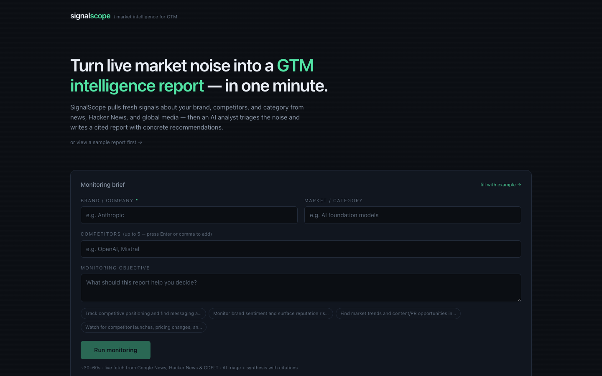

<p align="center">
  
</p>

# SignalScope

**Live brand and market monitoring for GTM teams.** SignalScope takes a brand, competitors, market category, and monitoring objective, then pulls fresh public signals, triages the noise with AI, and writes a cited market-intelligence report with concrete GTM recommendations.

It is designed for the gap between raw alerts and useful strategy: collect the signals, filter what matters, connect them to action, and keep every claim traceable to evidence.

## Preview



## What It Does

1. **Collects live signals** from Google News RSS, Hacker News, GDELT, and optional Tavily search.
2. **Scores relevance** with a fast AI triage pass so homonyms, spam, and off-topic results drop out.
3. **Synthesizes a report** with executive summary, sentiment, themes, competitor moves, opportunities, risks, and action items.
4. **Cites every claim** with evidence chips that jump back to the source signal.
5. **Exports Markdown** for sharing or follow-up analysis.

## Business Applications

SignalScope is a reference pattern for turning noisy public information into decision-ready intelligence. The same architecture can support:

- **Competitive intelligence:** monitor launches, pricing changes, positioning shifts, partnerships, and hiring signals across a market.
- **Brand and reputation monitoring:** separate meaningful coverage from keyword noise and summarize changes in sentiment or narrative.
- **Sales and account planning:** watch named accounts, competitors, and industry events so reps can personalize outreach with current evidence.
- **Founder or investor research:** track emerging categories, company momentum, and market risks without manually checking multiple sources.
- **Customer success risk detection:** monitor public complaints, outages, competitor mentions, or regulatory events that may affect key accounts.

The core transferable idea is a source-grounded intelligence pipeline: collect broad signals, filter them cheaply, synthesize only the relevant evidence, and keep the final recommendation auditable.

## Example Output

A generated report includes:

- **Executive summary:** what changed, why it matters, and what the GTM team should do next.
- **Signal themes:** grouped market, brand, competitor, and customer signals with citations.
- **Competitor moves:** notable launches, positioning shifts, partnerships, or public momentum.
- **Opportunities and risks:** practical recommendations grounded in the collected evidence.
- **Evidence panel:** source links and citation chips so reviewers can inspect the underlying signals.

## Pipeline

```text
Brief
  brand + competitors + category + objective
        |
        v
Collect
  Google News · Hacker News · GDELT · Tavily
        |
        v
Triage
  fast model scores relevance and removes noise
        |
        v
Synthesize
  analyst model writes a schema-checked cited report
        |
        v
Review
  report + evidence panel + Markdown export
```

## Architecture

| Layer | Implementation |
| --- | --- |
| App | Next.js App Router, React, TypeScript |
| Pipeline | `lib/pipeline.ts` orchestrates collect → triage → synthesize |
| Sources | Source adapters in `lib/sources/` |
| AI providers | Anthropic preferred, OpenAI fallback through Vercel AI SDK |
| Structured output | Zod schemas for requests, signals, stream events, and reports |
| Streaming | NDJSON progress events from `app/api/monitor/route.ts` |
| Evidence | Server strips invented citation IDs before the UI renders claims |

## Transferable Implementation Patterns

- **Two-pass AI pipeline:** a fast triage step reduces cost and noise before the higher-quality synthesis step.
- **Adapter-based source ingestion:** each signal source is isolated behind a small adapter, making it straightforward to add domain-specific feeds later.
- **Schema-checked reports:** Zod schemas define the shape of requests, stream events, signals, and reports so the UI can trust the API contract.
- **Auditable recommendations:** the report is only useful if a reviewer can inspect the supporting signal; citation filtering happens server-side before rendering.
- **Progressive streaming UX:** users see collection, triage, and synthesis progress instead of waiting on a silent long-running request.

## Run Locally

```bash
npm install
cp .env.example .env.local
npm run dev
```

Open <http://localhost:3000>, use the example brief, and run monitoring. A typical run takes 30-60 seconds.

## Smoke Test

With the dev server running:

```bash
npm run smoke
npm run smoke -- "Notion" "Coda,Airtable" "productivity software"
```

The smoke test streams pipeline events, validates that a report was produced, and checks that citations point to delivered signals.

## Environment Variables

| Variable | Required | Purpose |
| --- | --- | --- |
| `ANTHROPIC_API_KEY` | One AI provider key required | Preferred provider for triage and synthesis |
| `OPENAI_API_KEY` | One AI provider key required | Fallback provider when Anthropic is not set |
| `TAVILY_API_KEY` | No | Adds web search as a fourth source |
| `TRIAGE_MODEL` | No | Override the triage model |
| `SYNTHESIS_MODEL` | No | Override the synthesis model |

## Deploy

```bash
npm run build
npx vercel
```

Set `ANTHROPIC_API_KEY` or `OPENAI_API_KEY` in Vercel. Add `TAVILY_API_KEY` if you want broader web search.

## Engineering Notes

- **Keyless-first collection.** The default sources work without paid scraping or authenticated social APIs.
- **Two-stage model use.** A cost-efficient triage model filters noise before the synthesis model writes the final report.
- **Citations are enforced in code.** The UI only renders citation IDs that exist in the delivered signal set.
- **Source failures are isolated.** One source can fail without breaking the whole run.
- **No fake data on empty runs.** Thin evidence returns coverage notes and guidance instead of invented findings.

## Known Limits

- No X, LinkedIn, Instagram, or Reddit ingestion without authenticated or paid APIs.
- News snippets are shallow; a production version would fetch and summarize full article bodies for the top signals.
- Reports are session-scoped and export-only; there is no saved history or week-over-week diffing.
- Recency windows vary by source and are tuned for useful signal volume.

## License

MIT
